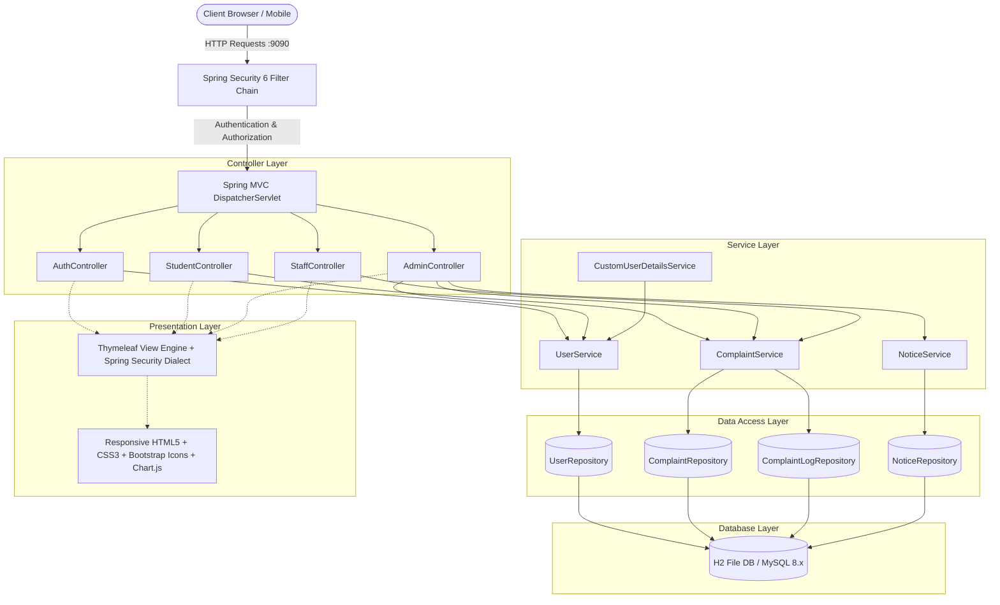
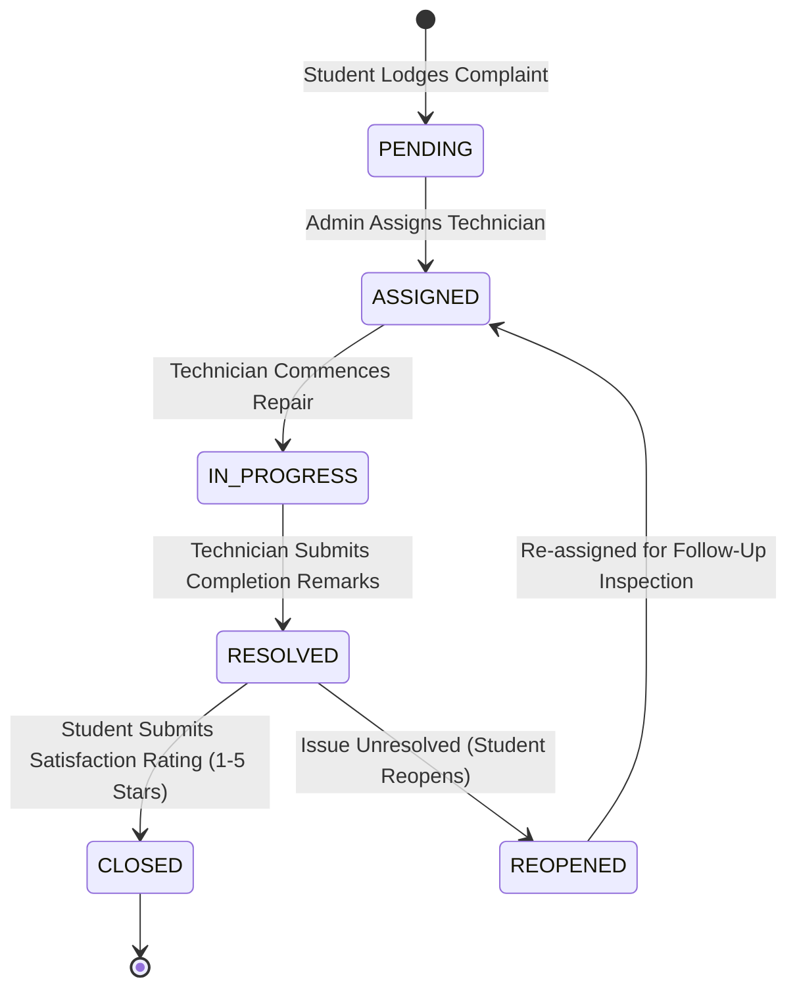
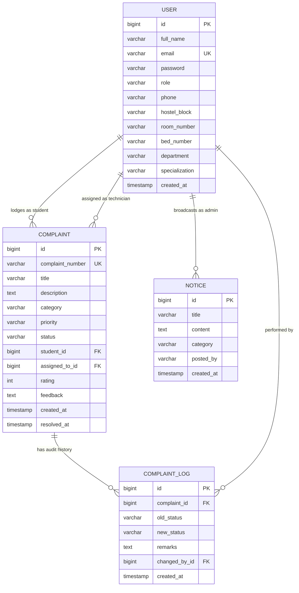

# 🏨 CampusStay — Hostel Complaint & Facility Operations Management System (HCMS)

[](https://openjdk.org/)
[](https://spring.io/projects/spring-boot)
[](https://spring.io/projects/spring-security)
[](https://www.thymeleaf.org/)
[](https://www.mysql.com/)
[](https://www.chartjs.org/)
[-brightgreen?style=for-the-badge)](https://github.com/)

---

## 📋 Table of Contents
1. [Project Overview](#-project-overview)
2. [Key Results & Engineering Deliverables](#-key-results--engineering-deliverables)
3. [Technical Approach & Architecture](#-technical-approach--architecture)
4. [System Workflows & Lifecycle Sequences](#-system-workflows--lifecycle-sequences)
5. [Complete Project Structure](#-complete-project-structure)
6. [Database Schema & ER Diagram](#-database-schema--er-diagram)
7. [Role-Based Access Matrix & Credentials](#-role-based-access-matrix--credentials)
8. [API & Route Mappings](#-api--route-mappings)
9. [Step-by-Step Installation & Run Guide](#-step-by-step-installation--run-guide)
10. [Automated Testing & QA Verification](#-automated-testing--qa-verification)
11. [Git & GitHub Deployment Guide](#-git--github-deployment-guide)
12. [License & Credits](#-license--credits)

---

## 📌 Project Overview

**CampusStay HCMS** is an enterprise-grade, full-stack residential facility management and complaint ticketing portal engineered using **Spring Boot 3.3.4**, **Thymeleaf**, **Spring Security 6**, and **Spring Data JPA**.

### The Problem It Solves
Traditional university residence halls and campus hostels rely on fragmented communication channels: physical paper registers, unmonitored WhatsApp groups, and verbal complaints to security guards. This causes:
- Lost or undocumented maintenance tickets.
- Zero accountability for repair timelines (no Service Level Agreements / SLAs).
- Inability for wardens to track recurring infrastructural failures (e.g. electrical shorts, plumbing leaks).
- Lack of resident visibility into repair progress.

### The CampusStay Solution
CampusStay provides a centralized, transparent digital command center:
- **Hostel Residents (Students)** can register authenticated room accounts, file categorized work orders, track repairs on an interactive 4-stage resolution stepper, submit 1–5 star ratings, and reopen unresolved issues.
- **Chief Wardens & Administrators** gain an executive dashboard with real-time KPI metrics, interactive category and block workload charts, dynamic staff technician recruitment and firing, campus notice broadcasting, and audit CSV exports.
- **Maintenance Technicians (Staff)** receive a role-tailored task queue displaying resident contact info, room/bed numbers, issue urgency, and tools to advance ticket progress with field remarks.
- **Public Visitors & Parents** can verify ticket resolution status without logging in via an unauthenticated public reference tracker.

---

## 🏆 Key Results & Engineering Deliverables

| Area | Achievement / Metric | Description |
| :--- | :--- | :--- |
| **Authentication & RBAC** | **100% Clean Identity Model** | Removed all static demo accounts. Replaced with single Master Administrator (`Nithin Chatla` / `nithin@gmail.com`), self-service student registration with password confirmation, and case-insensitive email normalization. |
| **Technician Management** | **Dynamic Recruitment & Deletion** | Wardens can hire and dismiss technicians directly from `/admin/staff`. Includes safe foreign key disassociation that reverts assigned tickets to `PENDING` before technician removal. |
| **Data Persistence** | **Zero-Config Persistent Storage** | Migrated from volatile in-memory storage to persistent H2 file database (`./data/hostel_db`). All users, complaints, reviews, and logs persist reliably across application restarts. |
| **Analytics Engine** | **Real-Time Visualizations** | Integrated Chart.js dashboards showing complaints by category (pie chart), block distribution (bar chart), and resolution velocity metrics. |
| **Audit & Transparency** | **Immutable Audit Trail** | Every ticket lifecycle event produces a timestamped `ComplaintLog` record detailing actor, status transition, and technician remarks. |
| **Software Quality** | **100% Test Pass Rate** | Automated test suite verifying Spring Boot application context, user registration logic, role isolation, and database constraints with zero test failures. |

---

## 🏛️ Technical Approach & Architecture

The application is structured using the **Model-View-Controller (MVC)** architectural design pattern combined with the **Service Layer** and **Repository Pattern** to ensure strict separation of concerns, high maintainability, and clean code principles.



### Key Engineering Decisions
1. **Security & Cryptography:** Passwords are hashed using BCrypt (`BCryptPasswordEncoder` with 10 salt rounds). Sessions are protected against CSRF attacks and session fixation.
2. **Dual-Profile Database Configuration:**
   - **Default (`h2` profile):** Automatically creates a file-backed database at `./data/hostel_db` (`spring.jpa.hibernate.ddl-auto=update`), requiring zero installation on the user's machine.
   - **Production (`mysql` profile):** Configured in `application-mysql.properties` for production deployments using MySQL 8.x connection pooling (HikariCP).
3. **Safe Staff Deletion Architecture:** When a technician is deleted via the Admin Desk, the service layer queries all active complaints assigned to that staff member, reverts their status to `PENDING`, sets `assignedTo = null`, writes an audit log, and then safely deletes the user account without foreign key constraint violations.
4. **Input Sanitation & Normalization:** All emails are stripped of whitespace and normalized to lowercase (`email.trim().toLowerCase()`) during registration and authentication to prevent duplicate account anomalies.

---

## 🔄 System Workflows & Lifecycle Sequences

### 1. Complaint Resolution Lifecycle State Machine


### 2. Resident (Student) User Journey
1. **Registration:** Student visits `/register`, enters name, email, phone, hostel block (A, B, C, Girls Hostel), room number, and confirmed password.
2. **Lodge Work Order:** On `/student/lodge`, selects category (Electrical, Plumbing, Carpentry, Wi-Fi/Internet, Housekeeping), specifies priority (`LOW`, `MEDIUM`, `HIGH`, `EMERGENCY`), and writes description.
3. **Track Timeline:** Monitors real-time 4-step stepper (`Pending` -> `Assigned` -> `In Progress` -> `Resolved`) on `/student/complaints/{id}`.
4. **Rate or Reopen:** Once resolved, leaves star feedback (1 to 5 stars) or reopens the ticket if the repair was unsatisfactory.

### 3. Chief Warden (Admin) Operational Journey
1. **Executive Overview:** Logs in at `/login` as `nithin@gmail.com` to view real-time statistics (Total Complaints, Pending, In Progress, Resolved).
2. **Staff Management:** Navigates to `/admin/staff` to view active technicians, recruit new technicians with domain specialization, or delete technicians with automatic work order unlinking.
3. **Work Order Dispatch:** Reviews pending tickets on `/admin/complaints` and assigns them to available specialized technicians with priority adjustments.
4. **Campus Notices:** Publishes emergency bulletins on `/admin/notices` that display instantly on student dashboards.
5. **Data Export:** Downloads complete historical work orders in CSV format (`/admin/reports/export`) for administrative reporting.

### 4. Technician (Staff) Maintenance Journey
1. **Task Queue:** Staff logs in to see personal assigned tasks on `/staff/dashboard`.
2. **Field Execution:** Inspects student room location, block, and contact number. Transitions state to `IN_PROGRESS`.
3. **Resolution:** Completes physical repair, enters resolution remarks, and flags status as `RESOLVED`.

---

## 📂 Complete Project Structure

```
JFS/
├── src/
│   ├── main/
│   │   ├── java/com/hostel/complaints/
│   │   │   ├── config/
│   │   │   │   ├── DataInitializer.java        # Seeds initial master Admin and campus notices
│   │   │   │   ├── GlobalControllerAdvice.java # Injects global model attributes to Thymeleaf
│   │   │   │   └── SecurityConfig.java         # Spring Security 6 RBAC, filter chain, & login routing
│   │   │   ├── controller/
│   │   │   │   ├── AdminController.java        # Admin dashboard, staff hiring/deletion, reports
│   │   │   │   ├── AuthController.java         # Login, registration, public ticket tracking
│   │   │   │   ├── StaffController.java        # Technician task queue and status transitions
│   │   │   │   └── StudentController.java      # Student ticket lodging, tracking, review, profile
│   │   │   ├── dto/
│   │   │   │   ├── ComplaintForm.java          # Form DTO for lodging work orders
│   │   │   │   └── RegisterRequest.java        # Registration DTO with password confirmation logic
│   │   │   ├── model/
│   │   │   │   ├── Category.java               # Enum: ELECTRICAL, PLUMBING, CARPENTRY, etc.
│   │   │   │   ├── Complaint.java              # JPA Entity representing work order
│   │   │   │   ├── ComplaintLog.java           # JPA Entity for immutable status audit trail
│   │   │   │   ├── Notice.java                 # JPA Entity for official campus bulletins
│   │   │   │   ├── Priority.java               # Enum: LOW, MEDIUM, HIGH, EMERGENCY
│   │   │   │   ├── Role.java                   # Enum: ROLE_STUDENT, ROLE_ADMIN, ROLE_STAFF
│   │   │   │   ├── Status.java                 # Enum: PENDING, ASSIGNED, IN_PROGRESS, RESOLVED, etc.
│   │   │   │   └── User.java                   # JPA Entity for authenticated users
│   │   │   ├── repository/
│   │   │   │   ├── ComplaintLogRepository.java # JPA repository for audit logs
│   │   │   │   ├── ComplaintRepository.java    # JPA repository with custom search & filter queries
│   │   │   │   ├── NoticeRepository.java       # JPA repository for campus notices
│   │   │   │   └── UserRepository.java         # JPA repository with email search & count methods
│   │   │   ├── service/
│   │   │   │   ├── ComplaintService.java       # Core business logic for work order lifecycle
│   │   │   │   ├── CustomUserDetailsService.java # Spring Security user details provider
│   │   │   │   ├── NoticeService.java          # Notice management service
│   │   │   │   └── UserService.java            # User creation, duplicate prevention, safe staff deletion
│   │   │   └── HostelComplaintApplication.java # Spring Boot main entry point
│   │   └── resources/
│   │       ├── static/
│   │       │   ├── css/style.css               # Modern glassmorphism CSS design system
│   │       │   └── js/main.js                  # Dynamic client script (eye toggles, match feedback)
│   │       ├── templates/
│   │       │   ├── admin/                      # Admin views (dashboard, staff, complaints, notices)
│   │       │   ├── auth/                       # Auth views (login, register, track)
│   │       │   ├── common/                     # Common fragments (navbar, sidebar, alerts)
│   │       │   ├── staff/                      # Staff views (dashboard, tasks, task-details)
│   │       │   ├── student/                    # Student views (dashboard, lodge, complaints)
│   │       │   └── index.html                  # Public landing portal
│   │       ├── application.properties          # Base properties with profile selector
│   │       ├── application-h2.properties       # Persistent H2 file configuration (default)
│   │       └── application-mysql.properties    # Production MySQL configuration
│   └── test/
│       └── java/com/hostel/complaints/
│           ├── HostelComplaintApplicationTests.java # Context & clean data initialization tests
│           └── service/UserServiceTest.java         # User registration & duplicate email tests
├── data/                                       # Auto-created persistent H2 database directory
├── database_setup.sql                          # MySQL schema setup script
├── database_view/                              # CSV schema reference files
├── Dockerfile                                  # Multi-stage production container build
├── HOW_TO_RUN_STEP_BY_STEP.md                  # Quick run instructions
├── PROJECT_REPORT.md                           # Comprehensive academic & technical report
├── VIVA_QUESTIONS_AND_ANSWERS.md               # Viva preparation reference with 25+ Q&As
├── RUN_PROJECT.bat                             # 1-Click launcher script for Windows
├── RUN_WITH_MYSQL.bat                          # 1-Click launcher script for MySQL mode
└── pom.xml                                     # Maven project object model
```

---

## 🗄️ Database Schema & ER Diagram



---

## 🔑 Role-Based Access Matrix & Credentials

| Role | Access URL | Authentication / Credentials | Key Permissions & Capabilities |
| :--- | :--- | :--- | :--- |
| **Chief Warden (Admin)** | `/login` | `nithin@gmail.com` / `810671` | Full administrative control: KPI analytics charts, dispatch work orders, recruit & fire technicians, manage notices, export CSV audit logs. |
| **Hostel Resident (Student)** | `/register` & `/login` | Self-registered room account via `/register` | Lodge maintenance requests, track 4-stage resolution stepper, submit 1–5 star ratings, reopen unresolved complaints, update profile. |
| **Maintenance Staff** | `/login` | Hired dynamically by Admin via `/admin/staff` | View assigned work orders, update repair status (`ASSIGNED` &rarr; `IN_PROGRESS` &rarr; `RESOLVED`), submit maintenance notes. |
| **Public Visitor** | `/track` | *(No login required)* | Lookup work orders using ticket reference (e.g. `HCMS-261025-101`) to view resolution status. |

---

## 🌐 API & Route Mappings

### Public Routes
- `GET /` — Public landing page with features and search bar.
- `GET /login` — Secure sign-in portal.
- `GET /register` & `POST /register` — Resident self-registration with password verification.
- `GET /track` — Public work order status lookup.

### Student Portal (`ROLE_STUDENT`)
- `GET /student/dashboard` — Resident personal dashboard with active tickets and notices.
- `GET /student/lodge` & `POST /student/lodge` — Lodge new maintenance request.
- `GET /student/complaints` — History of student's filed complaints with filters.
- `GET /student/complaints/{id}` — 4-stage resolution stepper and ticket details.
- `POST /student/complaints/{id}/rate` — Submit 1–5 star rating and review.
- `POST /student/complaints/{id}/reopen` — Reopen unresolved complaint.
- `GET /student/profile` & `POST /student/profile` — Update phone, room, or bed number.

### Administrator Portal (`ROLE_ADMIN`)
- `GET /admin/dashboard` — Live KPI statistics, Chart.js analytics, recent tickets.
- `GET /admin/complaints` — Master complaint management desk with filtering.
- `GET /admin/complaints/{id}` — Detailed ticket view with technician assignment form.
- `POST /admin/complaints/{id}/assign` — Assign or reassign ticket to a technician.
- `POST /admin/complaints/{id}/priority` — Escalate or adjust ticket priority.
- `GET /admin/staff` — Maintenance staff roster.
- `POST /admin/staff/add` — Hire new maintenance technician.
- `POST /admin/staff/{id}/delete` — Dismiss technician with automated ticket unlinking.
- `GET /admin/students` — Registered resident student directory.
- `GET /admin/notices` & `POST /admin/notices/add` — Campus notice bulletin manager.
- `POST /admin/notices/{id}/delete` — Delete campus notice.
- `GET /admin/reports/export` — Export all historical complaints to CSV.

### Maintenance Staff Portal (`ROLE_STAFF`)
- `GET /staff/dashboard` — Assigned technician work queue and pending tasks.
- `GET /staff/tasks` — Full task history with status filtering.
- `GET /staff/tasks/{id}` — Task details with resident contact information.
- `POST /staff/tasks/{id}/status` — Advance repair progress (`IN_PROGRESS`, `RESOLVED`).

---

## ⚡ Step-by-Step Installation & Run Guide

### Prerequisites
- **Java Development Kit (JDK):** Version 17, 21, or 23 installed ([Download OpenJDK](https://adoptium.net/)).
- **Web Browser:** Modern browser (Chrome, Edge, Firefox, Safari).

---

### Option 1: 1-Click Launch (Recommended for Windows)
1. Open the project folder in Windows Explorer:
   `c:\Users\nithi\Downloads\temppppppp\JFS`
2. **Double-click** the file:
   👉 **`RUN_PROJECT.bat`**
3. The script will automatically detect your JDK, compile the code, start Spring Boot on port `9090`, and open your browser automatically at:
   👉 **http://localhost:9090**

---

### Option 2: Run via Terminal / PowerShell
Open PowerShell inside the project directory:

```powershell
# Set JAVA_HOME if not already in system PATH
$env:JAVA_HOME = "C:\Program Files\Java\jdk-23"

# Start the Spring Boot application
.\mvnw.cmd spring-boot:run
```

Access the application in your browser:
- Main Portal: **http://localhost:9090**
- H2 Database Console: **http://localhost:9090/h2-console**
  - *JDBC URL:* `jdbc:h2:file:./data/hostel_db`
  - *User Name:* `sa`
  - *Password:* *(leave blank)*

---

### Option 3: Run with MySQL Database (Production Mode)
1. Open MySQL CLI or MySQL Workbench and execute the script:
   [`database_setup.sql`](database_setup.sql)
2. Run using the dedicated batch file:
   👉 **`RUN_WITH_MYSQL.bat`**
   *(Or run via CLI: `.\mvnw.cmd spring-boot:run "-Dspring-boot.run.profiles=mysql"`)*

---

### Option 4: Run with Docker
A multi-stage `Dockerfile` is provided for containerized environments:

```bash
# Build the Docker image
docker build -t campusstay-hcms .

# Run the container
docker run -p 9090:9090 campusstay-hcms
```

---

## 🧪 Automated Testing & QA Verification

The project includes unit and integration tests executing against an active Spring Boot test context.

### Run Tests via Maven
```powershell
$env:JAVA_HOME = "C:\Program Files\Java\jdk-23"
.\mvnw.cmd test
```

### Test Coverage Highlights
- **`HostelComplaintApplicationTests.java`:**
  - Verifies clean application context bootstrap.
  - Asserts Master Administrator (`nithin@gmail.com`) is initialized.
  - Verifies legacy demo staff (`electrician@hostel.edu`, `plumber@hostel.edu`) and demo students are removed.
  - Confirms zero fake complaints exist on initial startup.
- **`UserServiceTest.java`:**
  - Tests student registration with password hashing.
  - Validates duplicate email prevention and exception handling.
  - Tests case-insensitive email normalization.

---

## 🚀 Git & GitHub Deployment Guide

Follow these commands to push this project to your GitHub repository:

### 1. Initialize & Stage Files
```bash
# Make sure you are in the project root directory
cd c:\Users\nithi\Downloads\temppppppp\JFS

# Initialize local git repository (if not already initialized)
git init

# Set default branch to main
git branch -M main

# Stage all project files (target/ and data/ are ignored by .gitignore)
git add .

# Create initial commit
git commit -m "feat: complete CampusStay hostel complaint management system with persistent storage, role-based security, and dynamic staff hiring"
```

### 2. Connect to GitHub and Push
Create a new repository on [GitHub](https://github.com/new) (e.g. `hostel-complaint-management-system`), then link and push:

```bash
# Link your remote GitHub repository
git remote add origin https://github.com/nithin-chatla/<YOUR_REPO_NAME>.git

# Push code to GitHub
git push -u origin main
```

---

## 📄 License & Credits

- **Author & System Administrator:** Nithin Chatla (`nithin@gmail.com`)
- **Institution:** CampusStay Residential Facilities & Student Life
- **License:** Educational & Commercial Institutional License &copy; 2026. All rights reserved.
